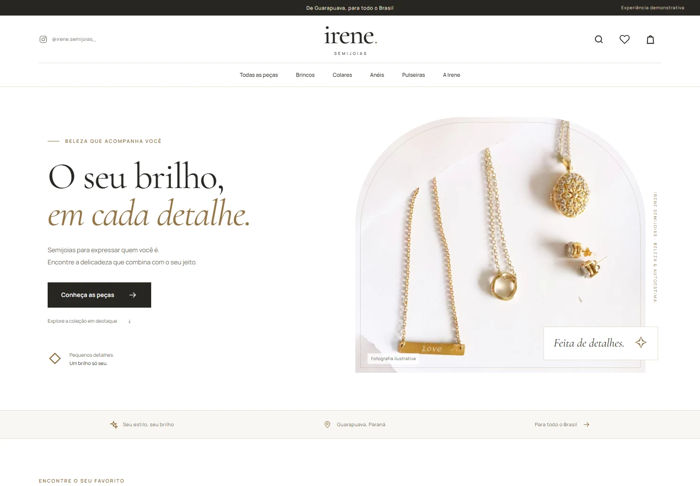

# Irene Semijoias — demonstração de loja virtual

Uma proposta navegável para apresentar à dona da marca. Interface em português, com foco no celular, catálogo local e checkout exclusivamente demonstrativo.



## Abrir localmente

Requisito: **Node.js 22.18 ou superior** e npm. Não precisa de arquivo de ambiente, credenciais, API, Express ou banco de dados.

```powershell
git clone https://github.com/henrriquelealbranco/irenejoias.git
cd irenejoias
npm ci
npm run dev
```

Abra **http://127.0.0.1:5187/**. O servidor de desenvolvimento é apenas o Vite que serve os arquivos do frontend. Para encerrar, pressione `Ctrl+C`. Se a porta estiver ocupada, escolha outra com `npm run dev -- --port 5190`.

Neste computador o checkout inicial está em `C:\Users\Lenovo\Desktop\Backup_Google_Drive\irene-semijoias-demo`.

## Gerar e conferir o build estático

```powershell
npm run build
npm run preview
```

Abra **http://127.0.0.1:5188/**. O build fica em `dist/`; publique **todo o conteúdo** dessa pasta em qualquer hospedagem estática. Build command: `npm run build`. Output directory: `dist`. Nenhum backend é necessário. O build usa caminhos relativos, permitindo publicação em subpastas.

A navegação utiliza rotas hash, dispensando configuração de reescrita de URLs e permitindo atualizar ou abrir diretamente qualquer página:

- `/#/catalogo`
- `/#/catalogo?categoria=Brincos`
- `/#/produto/argola-textura`
- `/#/produto/anel-luz`
- `/#/carrinho`
- `/#/favoritos`
- `/#/checkout`
- `/#/marca`
- `/#/sobre-a-demo`

Sirva a pasta `dist` por HTTP; abrir o HTML pelo protocolo `file://` não é o modo suportado para módulos JavaScript.

## Cloudflare Workers

O arquivo `wrangler.jsonc` publica somente os arquivos estáticos de `dist`, sem servidor ou banco de dados. O nome do projeto Cloudflare é `irenejoias`.

Configuração em **Settings → Build**:

- Root directory: deixe vazio para usar a raiz do repositório (não use `/irenesemijoias`).
- Build command: `npm run build`.
- Deploy command: `npx wrangler deploy`.
- Production branch: `main`.
- A versão de Node está fixada em `.node-version`. Se precisar defini-la no painel, use `NODE_VERSION=24.19.0`.

Para validar a configuração localmente sem publicar: `npx wrangler deploy --dry-run`. Para publicar pela CLI com uma conta Cloudflare autenticada: `npm run build` seguido de `npx wrangler deploy`.

## O que funciona

- Página inicial com banner, categorias, peças em destaque, apresentação da marca e Instagram.
- 12 produtos fictícios, três em cada categoria: brincos, colares, anéis e pulseiras.
- Busca sem distinção de acentos; filtros por categoria, coleção demonstrativa e preço; ordenação.
- Produto com fotografia, recorte identificado de detalhe, ampliação, seleção de aro para anéis e quantidade.
- Carrinho com variações separadas, alteração de quantidade, remoção e subtotal em reais.
- Favoritos e carrinho persistidos somente neste navegador; restauração ignora dados corrompidos.
- Checkout com identificação/endereço e validação local dos campos.
- Confirmação de simulação sem enviar dados, cobrar, registrar pedido ou salvar informações pessoais.
- Estados vazios e página de endereço não encontrado.

## O que foi simulado

Produtos, coleções, preços, aros e disponibilidade são exemplos. Não há avaliações, descontos, garantias ou condições comerciais inventadas. Frete não é calculado; o resumo mostra somente o subtotal demonstrativo.

As fotografias licenciadas de banco de imagens são **ilustrativas e não representam peças reais da Irene**. Galerias apresentam a imagem e um recorte da mesma fotografia, sem inventar ângulos adicionais. A composição tipográfica do nome é uma proposta visual, não a logo original.

O checkout mostra explicitamente: **“Esta é uma demonstração. Nenhum pedido ou pagamento será realizado.”** Recomenda-se preencher com dados fictícios. Nenhuma informação do formulário é armazenada em `localStorage`, enviada a um endpoint ou incorporada a um pedido. O carrinho permanece disponível após a simulação.

Os únicos dados persistidos são carrinho e favoritos, na chave `irene_semijoias_demo_v1`. Para reiniciar a experiência, apague essa chave no armazenamento do navegador. Se o navegador bloquear armazenamento, a experiência continua em memória e exibe um aviso.

Imagens e fontes estão no projeto. Não há requisições externas para executar a loja. Links externos só abrem após clique:

- Instagram: [@irene.semijoias_](https://www.instagram.com/irene.semijoias_/).
- WhatsApp: [(42) 99999-2166](https://wa.me/5542999992166), confirmado no link legível do print fornecido. O link não inclui mensagem e não envia nada automaticamente.

## Para a implementação definitiva

Depois da aprovação: catálogo e fotos reais, identidade final, preços/estoque confirmados, condições comerciais, frete, pagamentos seguros e gestão de pedidos. Contas e painel administrativo poderão ser definidos conforme a necessidade. Nada disso foi implementado nesta etapa.

## Testes

Testes de lógica, sem dependências adicionais:

```powershell
npm test
```

Verificação de comportamento no navegador (opcional para quem só quer abrir a loja):

```powershell
python -m pip install playwright
python -m playwright install chromium
npm run dev
```

Em outro terminal, na pasta do projeto:

```powershell
python tests/browser_qa.py --url http://127.0.0.1:5187
```

Também pode executar contra o build servido por `npm run preview`, usando a porta `5188`. Screenshots e relatório ficam em `artifacts/qa/`, ignorados no Git. Detalhes da conferência em [docs/verification.md](docs/verification.md).

## Base e licenças

Adaptado de [Lumiere, de Mehrab Gholamsamani](https://github.com/mehrabgholamsamani/Lumiere), a partir do commit `9be8ecc`. Mantidos React/Vite, o padrão de contexto/reducer do carrinho, os ícones originais e a composição de cabeçalho, cards e catálogo. Componentes foram adaptados à Irene; animações GSAP/Three.js e módulos Express/MongoDB/autenticação/admin foram removidos.

O arquivo [LICENSE](LICENSE) e o copyright **Copyright (c) 2026 Mehrab Gholamsamani** foram preservados. Uma cópia está em `public/LICENSE.txt` e acompanha o build. Atribuições complementares em [THIRD_PARTY_NOTICES.md](THIRD_PARTY_NOTICES.md).

Fotografias: [créditos e origens verificáveis](public/images/demo/CREDITS.md), [manifesto completo](public/images/demo/credits.json), [licença Pexels](https://www.pexels.com/license/). Imagens não verificadas do catálogo original foram retiradas do projeto atual. Fontes locais Cormorant Garamond e Manrope sob SIL Open Font License, com textos em `public/licenses/`.
